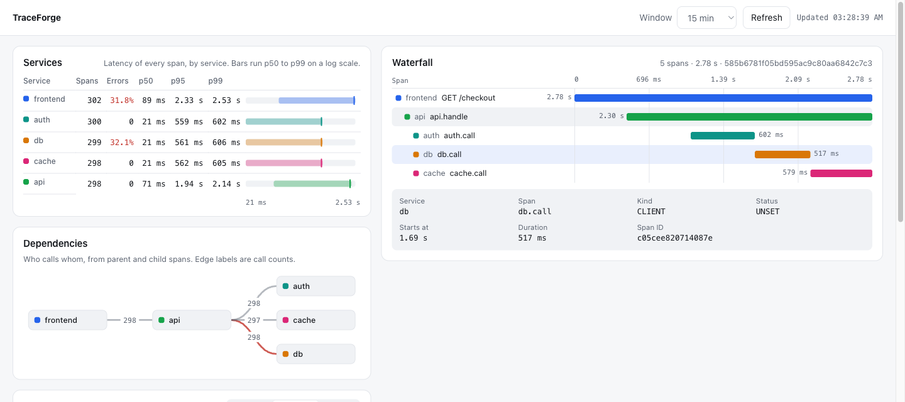

# TraceForge

**A distributed tracing platform.** OTLP-compatible ingestion over gRPC/HTTP,
Kafka-partitioned event routing by `trace_id`, tail-based sampling with
out-of-order trace reconstruction, and columnar analytics on ClickHouse.

**Stack:** Go · OpenTelemetry (OTLP) · gRPC/HTTP · Kafka · ClickHouse · Docker

---

## Why

Point any OpenTelemetry SDK or Collector at TraceForge and it ingests spans,
decides what to keep *after* seeing the whole trace (tail sampling), and stores
the survivors in ClickHouse for fast analytical queries — waterfall traces,
per-service RPS, p50/p95/p99 latency heatmaps, and auto-generated service
dependency graphs.

## Architecture

```
OTLP (gRPC :4317 / HTTP :4318)
        │
        ▼
   collector ──produce(key=trace_id)──►  Kafka: spans
                                              │
                             ┌────────────────┘
                             ▼
                          sampler  (buffer per trace → tail policies)
                             │  produce kept traces
                             ▼
                       Kafka: spans.kept
                             │
                             ▼
                          writer  (batched async bulk insert)
                             │
                             ▼
                        ClickHouse  (spans + materialized views)
                             ▲
                             │ SQL
                          query API  (waterfall / latency / dependencies)
```

See [docs/ARCHITECTURE.md](./docs/ARCHITECTURE.md) for the span lifecycle
walkthrough and [SPEC.md](./SPEC.md) for the full design.

## Components

| Service     | Path              | Role                                              |
|-------------|-------------------|---------------------------------------------------|
| `collector` | `cmd/collector`   | OTLP gRPC/HTTP ingest → Kafka (keyed by trace_id) |
| `sampler`   | `cmd/sampler`     | Tail-based sampling + trace reconstruction        |
| `writer`    | `cmd/writer`      | Batched async ClickHouse writer                   |
| `query`     | `cmd/query`       | Analytical HTTP API                               |
| `loadgen`   | `cmd/loadgen`     | OpenTelemetry traffic generator for load tests    |

## Quickstart

```bash
# 1. bring up Kafka + ClickHouse + all services
make up

# 2. generate synthetic OTLP traffic
make loadgen

# 3. query
curl "localhost:8080/api/latency?service=frontend&since=1h"
curl "localhost:8080/api/dependencies?since=1h"
curl "localhost:8080/api/traces/<trace_id>"
```

## Web UI

The query service also serves a small web UI at <http://localhost:8080>, built from
`web/static` and embedded in the binary (no separate build step):

- **Services**: span volume, error rate and p50/p95/p99 latency for every service, with
  each service's p50 to p99 range drawn on a shared log scale.
- **Dependencies**: who calls whom, from parent and child spans, with call counts; edges
  carrying errors are red.
- **Traces**: recent, slowest or failed traces; pick one to open its waterfall, with
  spans nested under their parents on the trace's time axis.

```bash
make up        # Kafka, ClickHouse and the four services
make loadgen   # send real OTLP traffic through the pipeline
make ui        # prints the URL (http://localhost:8080)
```



## Query API

| Endpoint                                   | Powers                        |
|--------------------------------------------|-------------------------------|
| `GET /api/traces?sort=&errors=&since=`     | Trace list (recent, slowest, failed) |
| `GET /api/traces/:trace_id`                | Waterfall view                |
| `GET /api/services?since=`                 | Per-service volume, errors, p50/p95/p99 |
| `GET /api/latency?service=&since=`         | Latency heatmap (p50/p95/p99) |
| `GET /api/dependencies?since=`             | Service dependency graph      |

Metrics are exposed per service on `/metrics` (Prometheus) at ports `9101–9104`.

## Development

```bash
make build     # go build ./...
make test      # go test ./...
make tidy      # go mod tidy
make bench     # load test at increasing rates
```

## Status

Milestone skeleton (M1). See [SPEC.md §8](./SPEC.md#8-milestones) for the roadmap.
